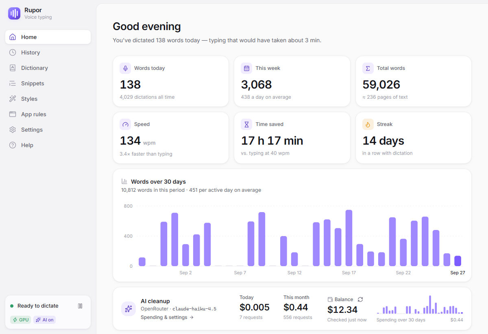
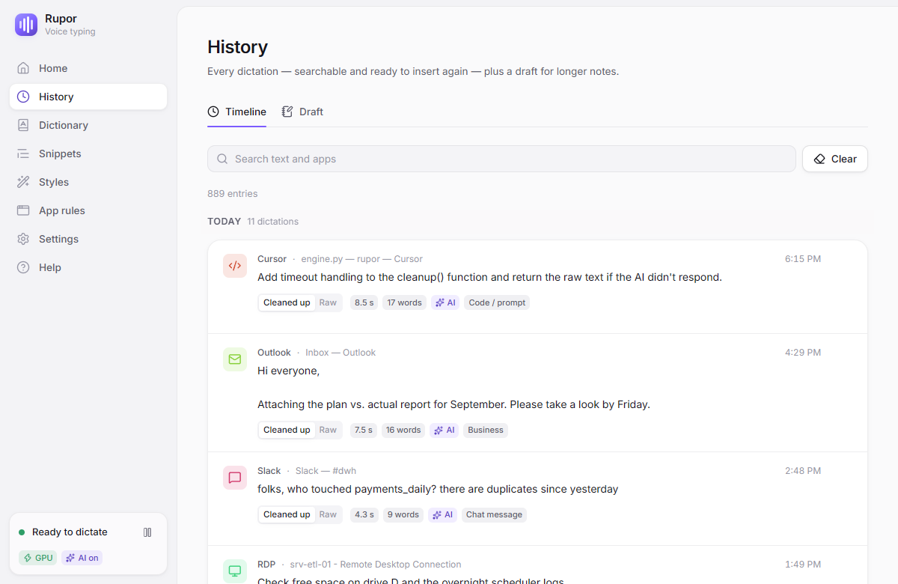
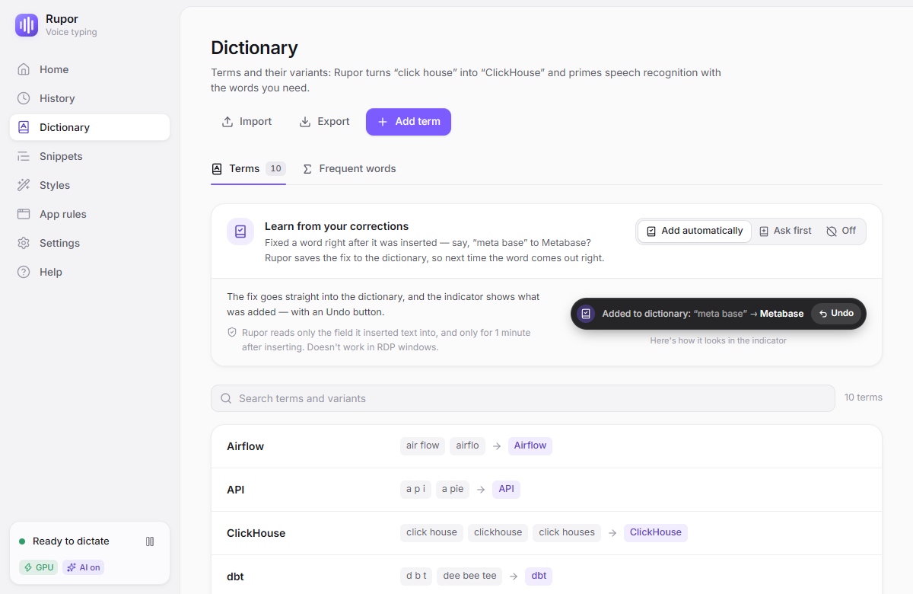
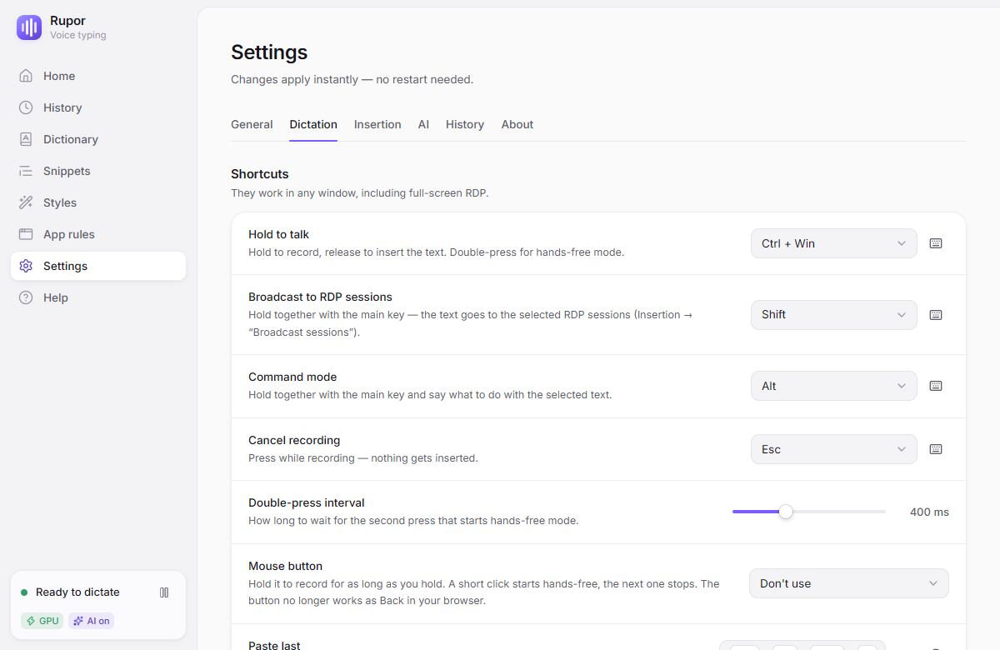
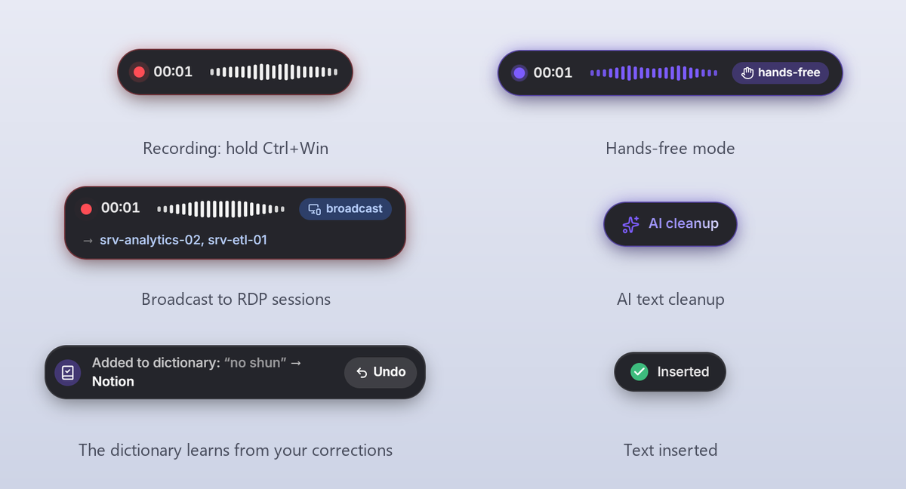
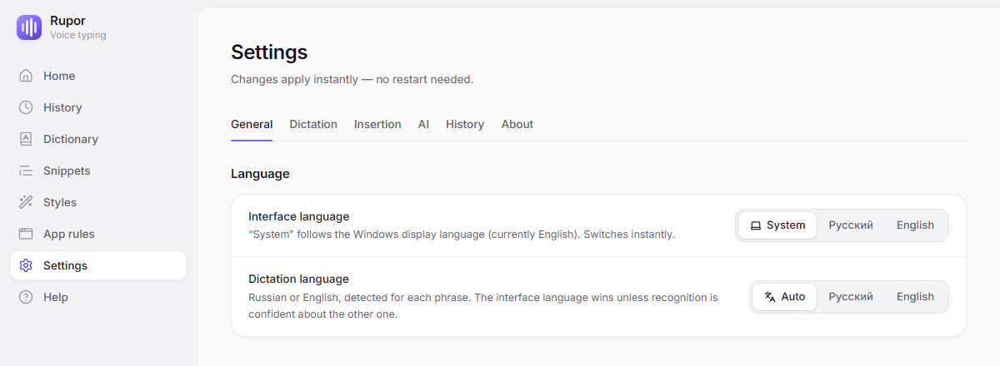

# Rupor — voice dictation for Windows

**English** · [Русский](README.ru.md)

**Rupor** (Russian *Рупор*, "megaphone") is a free, open-source voice dictation app for Windows.
Hold **Ctrl+Win**, say a phrase, release — the text appears wherever your cursor is. Rupor works
in any app: browsers, messengers, email, IDEs, Office — and in **Remote Desktop (RDP) sessions**,
even with the clipboard disabled (there it types the text as keystrokes). One phrase can go to
several remote sessions at once.

Speech recognition runs **locally on your graphics card** (faster-whisper `large-v3-turbo`, CUDA):
your voice never leaves the computer, and after the first-run setup no internet connection is
needed. A 13.5-second phrase is inserted about 0.65 s after you release the keys (RTX 3060 Ti).
Optionally, turn on **AI cleanup** through your own OpenRouter account. It removes filler words,
fixes punctuation and shapes the text for the task: a business email, a chat message, a prompt for
a coding assistant. It's the same idea as Wispr Flow, but recognition is local and there are modes
built for remote desktops.

The interface is available in **English and Russian** and switches on the fly in Settings.
Dictation understands English and Russian, including English terms inside Russian speech.



## Contents

- [Screenshots](#screenshots)
- [Features](#features)
- [Languages](#languages)
- [System requirements](#system-requirements)
- [Installation](#installation)
- [Usage](#usage)
- [Dictionary, snippets, history](#dictionary-snippets-history)
- [AI cleanup](#ai-cleanup)
- [Privacy and data](#privacy-and-data)
- [Settings](#settings)
- [Benchmarks](#benchmarks)
- [Building from source](#building-from-source)
- [Project structure](#project-structure)
- [License](#license)
- [Acknowledgements](#acknowledgements)

## Screenshots

| | |
|---|---|
|  |  |
| **History**: search, raw and cleaned-up text, insert again | **Dictionary**: terms, spelling variants, learning from your corrections |
|  |  |
| **Settings**: shortcuts, insertion, AI, history | **The indicator** at the bottom of the screen: recording, hands-free, broadcast, AI, dictionary |

The screenshots were taken in the interface's demo mode; all data in them is made up.

## Features

- **Dictation into any window.** Hold the key and talk, or double-press it for hands-free mode.
  You can also start recording with the mouse: click the indicator or use a mouse button.
- **RDP and virtual machines.** In `mstsc`, mRemoteNG, RDCMan, RemoteApp, Citrix, Hyper-V,
  VMware and VirtualBox the text is typed as keystrokes and gets through even with the clipboard
  disabled. Any alphabet (Cyrillic included) and emoji are typed regardless of the keyboard layout.
- **Broadcast to RDP**: one phrase goes to every selected remote session in turn.
- **Local recognition** on the GPU (CUDA). Without an NVIDIA graphics card Rupor runs on the CPU.
- **AI cleanup** (optional): removes fillers and self-corrections, fixes punctuation, formats the
  text to a style. If the AI doesn't respond, the raw text is inserted — **you never lose a
  dictation**.
- **Command mode**: select some text, hold Ctrl+Win+Alt and say "make it more polite",
  "translate to German" or "cut it in half" — the selection is replaced with the result.
- **Dictionary** of terms and spelling variants ("click house" → ClickHouse), with Russian case
  endings handled. Dictionary terms are passed to recognition as hints.
- **The dictionary learns from your corrections.** Fix a word right after it's inserted and
  Rupor suggests (or adds right away) the replacement, so next time the word comes out right.
- **Frequent words and context.** Names and terms from your dictations, as well as the text
  before the cursor, are passed to recognition as hints. All of this is computed and stored on
  your computer (terms are sent to AI cleanup only if it's on).
- **Snippets**: a voice trigger → ready-made text ("my email" → your address).
- **App rules**: a custom insert method and AI style for a program or for windows with a certain
  title (Telegram — Chat message, VS Code — Code / prompt).
- **History and draft**: search, insert again, retention period. You can also keep no history.
- **Stats**: words dictated, speed, time saved, day streak.
- **Lowers other apps' audio** while you record: music, a call, sound from an RDP session.
- **English and Russian**: the interface switches on the fly; dictation language is detected
  for each phrase or set explicitly.
- Tray icon, start with Windows, light and dark themes, accent color, first-run wizard.

## Languages

Rupor works in English and Russian — both the interface and the dictation.

- **Interface language** — Settings → General → Language: *System* (default), *Русский*,
  *English*. *System* follows the Windows display language: Russian for Russian, Belarusian,
  Ukrainian and Kazakh, English for everything else. The change applies immediately, without a
  restart: windows, the tray menu, notifications and errors from the engine, and AI style names
  switch together. The setup wizard starts with the same choice.
- **Dictation language** — right below it: *Auto* (default), *Русский*, *English*. In *Auto*,
  each phrase is recognized in the interface language unless the model is confident that you
  spoke the other one (the `en_threshold` setting, 0.8 by default). *Русский* or *English* pins
  the language and skips detection.
- **AI cleanup** uses a prompt in the language of the dictated text: English dictation is cleaned
  up by an English prompt (*um, uh, like, you know, basically*, self-corrections like *no wait…*
  or *scratch that*), Russian dictation by the Russian one. Command mode follows the interface
  language.
- **The installer** asks for its language (English or Russian): the setup wizard, the uninstaller
  and the entry in Installed apps (name and publisher) use the name in that language. Where the
  name is part of the installation itself, the app keeps its original Cyrillic name "Рупор", so
  existing installations keep their path and autostart: the install folder
  (`%LOCALAPPDATA%\Рупор`), the Start menu and desktop shortcuts, the installer's
  reinstall/upgrade page ("Рупор <version> is already installed…") and — since the name is built
  into `rupor.exe` — Task Manager, Startup apps and the notification-area icon settings.



## System requirements

| | |
|---|---|
| OS | Windows 10 or 11, 64-bit |
| Graphics card | NVIDIA GeForce RTX 20xx or newer recommended, 4 GB of video memory or more, a driver with CUDA 12 support (528 or newer; the latest is best). Without NVIDIA, recognition runs on the CPU — it works, but noticeably slower |
| Disk | about 3 GB: the app ≈ 0.3 GB, the speech model ≈ 1.6 GB, the CUDA cuBLAS library ≈ 0.55 GB |
| Internet | only on first launch (downloading the model and cuBLAS) and for AI cleanup, if you turn it on |
| Other | a microphone; the WebView2 runtime (usually already there on Windows 10/11; if not, the installer downloads it) |

## Installation

1. Download `Rupor_<version>_x64-setup.exe` from the
   [Releases](https://github.com/listapad2024/rupor/releases/latest) page.
2. Run the installer and pick its language. The installer isn't signed with a publisher
   certificate, so Windows SmartScreen shows "Windows protected your PC" with "Unknown
   publisher". Click **More info → Run anyway**. Your browser may also warn that the file isn't
   commonly downloaded. If you'd rather not run someone else's build, build the installer
   yourself — see [Building from source](#building-from-source).
3. Rupor installs for the current user into `%LOCALAPPDATA%\Рупор`; no administrator rights are
   needed. It lives in the tray: click the icon to open the window.
4. On first launch the setup wizard opens:
   1. interface language;
   2. microphone selection and a level check;
   3. a graphics card check and the download of the speech model (≈ 1.6 GB, from Hugging Face)
      and the CUDA cuBLAS library (≈ 0.55 GB, from PyPI) — once; after that everything works
      offline;
   4. a test phrase — say something and see the result;
   5. shortcuts;
   6. an OpenRouter key for AI cleanup (you can skip this step);
   7. start with Windows.

"Start with Windows" is on by default; you can turn it off in the wizard or in Settings →
General. After setup Rupor starts straight to the tray. If the model and libraries are already on
the computer at first launch, the wizard is skipped.

**Uninstalling**: Windows Settings → Apps → Installed apps (on Windows 10 — Apps & features) →
Rupor (Рупор if you installed it in Russian) → Uninstall. The "Delete the application data"
checkbox wipes settings, history, logs, the CUDA libraries and the AI keys in Credential Manager.
The model lives in the shared Hugging Face cache
(`%USERPROFILE%\.cache\huggingface\hub\models--mobiuslabsgmbh--faster-whisper-large-v3-turbo`);
delete it by hand if you need to.

## Usage

| Action | How (default) |
|---|---|
| Hold to talk | hold **Ctrl+Win**, speak, release — the text is inserted |
| Hands-free | **double-press** Ctrl+Win, speak, press Ctrl+Win once more at the end |
| Broadcast to RDP sessions | while recording, also hold **Shift** (Ctrl+Win+Shift) |
| Command mode | select text, hold **Ctrl+Win+Alt**, say what to do with it, release |
| Mouse: the indicator | **click the indicator** — hands-free recording, click again — stop and insert; right-click — the Rupor window |
| Mouse: a button | Settings → Dictation → Mouse button: the wheel or a side button; hold — record, short press — hands-free |
| Cancel recording | **Esc** while recording |
| Paste last | **Ctrl+Alt+Shift+V** (or the tray menu item) |
| Copy last | **Ctrl+Alt+Shift+C** |

All keys can be changed in Settings → Dictation and apply immediately, without a restart. The
dictation key can be a combination of modifiers (Ctrl+Alt…) or a single key (Right Ctrl, F13…).

**The indicator** is a small pill at the bottom of the screen. It shows recording (a live
waveform and a timer), transcription, AI processing and errors. It never takes focus, so the text
goes to your window. You can drag it anywhere or hide it in Settings.

**Broadcast to RDP.** Select the sessions you need in Settings → Insertion → Broadcast sessions
or in the tray menu. A session is the server name from the `mstsc` window title (for mRemoteNG
and RDCMan — the whole manager window). When you dictate with Shift, Rupor activates the windows
of the selected sessions one by one, types the text and returns focus; while you record, the
indicator shows where the text will go. If no open session is selected, the text isn't sent
anywhere, and you can insert it with Paste last. If focus moves during a broadcast (a click,
Alt+Tab, a disconnect dialog), the broadcast stops. In mRemoteNG and RDCMan all tabs are one
window, so only the active tab gets the text.

**Command mode** works through AI: OpenRouter or the local Claude Code CLI (`claude -p`). Rupor
reads the selected text, sends it to the AI together with your command and replaces the selection
with the answer. If in the meantime you switched windows, pressed keys or the selection changed,
the answer isn't inserted but kept for Paste last. Command mode doesn't work in terminals or in
RDP sessions without a shared clipboard.

<details>
<summary><b>More: keys, insert methods, rules, audio</b></summary>

#### Keys

- Regular Ctrl+Win shortcuts (Ctrl+Win+D, Ctrl+Win+arrows) keep working: if another key is
  pressed while you hold the combination, the recording is quietly discarded. Holding for less
  than 0.25 s doesn't count as dictation either.
- Shift and Alt pressed during recording don't reach apps (Alt+Shift won't switch the keyboard
  layout), and Win released after dictation doesn't open Start. An Esc that canceled a recording
  doesn't reach the window either. After Ctrl+Alt+Del, a UAC prompt or locking the screen, held
  keys are reset.
- You can start the next phrase while the previous one is still being typed: typing waits until
  you release the keys, so a line break won't turn into Ctrl+Enter.
- A recording longer than 10 minutes stops by itself (say, if you forgot to turn off
  hands-free). If the microphone stops delivering sound (a headset was reconnected), Rupor tells
  you and reopens the device.
- If Ctrl+Alt "doesn't work", check whether the key labeled Alt actually sends Win (some
  keyboards do this in "Mac mode"): Rupor listens to what Windows sees.

#### Insert methods

- **Auto** (default): into RDP clients, RemoteApp, Citrix and virtual machine consoles the text
  is **typed as keystrokes**; everywhere else it's **pasted via the clipboard** (the previous
  clipboard contents are restored afterwards).
- **Keystrokes**: `SendInput` with `KEYEVENTF_UNICODE`. Any alphabet and emoji get through
  regardless of the keyboard layout, and it works in RDP with the clipboard off. Line breaks and
  Tab are sent as scan codes, so RDP doesn't drop them.
- **Clipboard**: save the clipboard → Ctrl+V → wait until the window takes the text → restore the
  clipboard. The temporary text is marked so it stays out of Windows clipboard history (Win+V),
  cloud sync and clipboard managers.

Text is inserted only into the window where you dictated. If a different window is active by the
time of insertion, or focus moves in the middle of typing, the rest won't land in the wrong
window: the text stays in Paste last and in the history.

**Windows running as administrator** don't accept input from regular programs (UIPI). Rupor
warns you and offers to restart itself as administrator.

**Clipboard limitations**: while Rupor pastes, the app loses clipboard ownership — a range cut in
Excel (Ctrl+X) will be pasted as a copy after dictation, and Office shapes aren't restored. If
that gets in the way, give the app a Keystrokes rule.

#### App and window title rules

**App rules** set the insert method and AI style for a program. Out of the box: Telegram — Chat
message, Outlook — Business, Cursor and VS Code — Code / prompt. The App rules page lists
recently used programs, so a rule takes one click to add.

**Window title rules** are more specific than app rules: "in Chrome, if the title contains
YouTube Studio — Business style", "in any window with `srv-analytics` — keystrokes". The process
is an exe name or `*` (any window); the title is a case-insensitive part of the window title; it
works for browser tabs too. Priority: title rule (of several matches — the one with the longest
title) → app rule → general settings.

#### Computer audio while recording

While you record, Rupor can lower other apps' audio — music, video, a call, sound from a remote
computer over RDP — to a set level (15% by default) or mute it, and afterwards puts everything
back. Setting: Settings → Dictation → Computer audio while recording (Leave as is / Lower /
Mute).

Rupor changes per-app volume in the Windows mixer, not the master volume: its own sounds and
Windows system sounds are left alone. An app that starts playing during recording is lowered
too. If you change an app's volume yourself while recording, Rupor leaves it alone and doesn't
"restore" it afterwards. If Rupor crashes mid-recording, the volume is restored on the next
launch (changes are written to `%APPDATA%\Rupor\duck.json` in advance).

</details>

## Dictionary, snippets, history

- **Dictionary**: a term and its spelling variants ("click house", "clickhouse" → ClickHouse).
  Replacement works on whole words, ignoring case (and ё/е in Russian), and handles Russian case
  endings («в клик хаусе» → «в ClickHouse»). Dictionary terms are passed to recognition as hints. The
  dictionary can be imported and exported as JSON.
- **Learning from corrections.** After inserting, Rupor watches the input field for up to a
  minute (via Windows UI Automation: Notepad, Telegram Desktop, fields in Chromium-based browsers,
  Word). If you fix a word that was misrecognized ("meta base" → Metabase), the indicator shows a
  notification. Modes (`learn_mode`): **Add automatically** — with an Undo button (default),
  **Ask first** — with an Add button, **Off**.
- **Frequent words**: Rupor picks words typical for you from the history — Latin-script terms,
  abbreviations, names, rare words — and passes them to recognition as hints. Any word can be
  excluded. With history off, frequencies aren't collected.
- **Text in the window**: when you press the key, Rupor reads 1–2 sentences before the cursor and
  passes them to recognition, so a continued sentence is recognized more accurately. The text is
  never stored.
- **Snippets**: a voice trigger → text ("my email" → your address). If a snippet fires, AI isn't
  called. Snippets are also imported and exported as JSON.
- **History**: time, app, raw and cleaned-up text, duration; search, copy, insert again, delete,
  clear the last day/week/month, retention period. History can be turned off entirely.
- **Draft** (a tab in History): dictate a long note right into the Rupor window, without
  inserting it into other programs.
- **Stats** on Home: words per day/week/all time, speed (words per minute), time saved compared
  to typing (40 words per minute), day streak, a 30-day chart. Always counted, even with history
  off.

<details>
<summary><b>More: what gets learned and what doesn't</b></summary>

Rupor learns only corrections that look like recognition errors: the new word looks like a term
(Latin script, digits, mixed case like ClickHouse, an abbreviation, a capitalized name not at the
start of a sentence) and sounds similar to the old one.

Not learned: replacing a word by meaning ("tomorrow" → "the day after tomorrow"), grammar (a
different Russian case form, «Наташа» → «Наташе»), swapping a similar product or number
(React → Preact, TASK-12 → TASK-13), translating an ordinary word («проект» → project),
formatting and capital letters on ordinary words, punctuation, deleting and adding words,
numbers, words shorter than 3 letters, and common words.

In doubtful cases Rupor asks even in Add automatically mode, and adds the word by itself on the
second identical correction: a short word (up to 4 letters), one name replaced with a similar
one, only a capital letter added to a Russian word, a switch to lowercase Latin
(«вебхук» → webhook), a correction inside English text, a word that stayed in the field for less
than a second. A half-typed word (Enter right after the last letter) is never learned.

Watching the field ends when focus leaves it, when the field is cleared (the message was sent),
after a minute, or when a new dictation starts. RDP windows, broadcasts and command mode aren't
watched, and password fields are never read. The field's text isn't sent anywhere or written to
the logs.

</details>

## AI cleanup

AI cleanup is **off** by default: without it Rupor works fully offline. Turn it on in
Settings → AI.

- **Provider.** The default is [OpenRouter](https://openrouter.ai) with
  `anthropic/claude-haiku-4.5` (you can change the model). The Anthropic API directly (with your
  own key) and [Ollama](https://ollama.com) — a local model, fully offline — are supported too.
  You need **your own account** with the provider: requests are billed to your balance. One
  cleanup costs around $0.001 (measurements are in [docs/BENCH.md](docs/BENCH.md)).
- **The key** is stored only in Windows Credential Manager (entries `Rupor/openrouter`,
  `Rupor/anthropic`). Paste it in Settings or import it from a `.env` file with an
  `openrouter_api_key` variable. The interface shows only a mask like `sk-or-v1-…XYZ`; the key
  never gets into logs or history.
- **Styles**: As is (no AI), Standard, Business, Chat message, Code / prompt. The style comes
  from the app rule; otherwise the default style is used.
- **Language**: the prompt matches the dictated text. English dictation gets an English prompt
  (fillers like *um, uh, like, you know, basically* and self-corrections go away; numbers, terms
  and lists are formatted; questions in the text are never answered), Russian dictation gets the
  Russian one. When the text is ambiguous (a couple of words, mixed scripts), the recognition
  language decides.
- **Modes**: *Wait for cleanup* — only the cleaned-up text is inserted; *Raw text first* — the text
  is inserted right away and replaced with the cleaned-up version when it arrives (only if you
  haven't pressed anything, the window and the field are the same, and the text left of the
  cursor is exactly what was inserted).
- Phrases shorter than a threshold (6 words by default) aren't sent to AI. On an error or a
  timeout (5 s) the raw text is inserted and you get a notification.
- **Spending**: every call is logged locally (model, tokens, cost). Settings → AI → Spending
  shows totals for the day, week, month and all time, a daily chart and the OpenRouter balance.
  If the balance drops below $1, Rupor warns you (at most once a day).

**What goes over the network with AI on.** The provider receives the recognized text of the
phrase, the instruction for the selected style and a list of terms (from your dictionary and
frequent words) so the AI spells them right. In command mode — your voice command and the
selected text. Audio, history, window titles and text from input fields aren't sent. To check the
key and balance, Rupor calls OpenRouter (`/api/v1/key`, `/api/v1/credits`) when you click Check,
and automatically at most once every 5 minutes — only if cleanup or commands go through
OpenRouter. With Ollama everything stays on your computer.

## Privacy and data

- **Recognition is local.** Microphone audio is processed on your computer and never stored.
- **No telemetry or analytics.** Rupor goes online only for the model (Hugging Face) and cuBLAS
  (PyPI) on first launch, and to your AI provider if AI is on.
- **Dictated text isn't written to logs**: only text lengths, timings and program names.
- The engine and the windows talk over WebSocket on `127.0.0.1` with a random port and token;
  web pages in a browser can't connect to the engine.
- A deleted history entry is wiped both in the database and in its journal (`rupor.db-wal`).

| What | Where |
|---|---|
| Settings | `%APPDATA%\Rupor\settings.json` |
| History, dictionary, snippets, stats, draft, AI spending, frequent words | `%APPDATA%\Rupor\rupor.db` (SQLite) |
| Logs (rotated; log messages are in Russian) | `%APPDATA%\Rupor\logs\` (`rupor.log`, `ui.log`, `crash.log`) |
| Volume of lowered apps (only while recording) | `%APPDATA%\Rupor\duck.json` |
| Speech model | `%USERPROFILE%\.cache\huggingface\hub` |
| CUDA libraries | `%LOCALAPPDATA%\Rupor\cuda` |
| AI keys | Windows Credential Manager: `Rupor/openrouter`, `Rupor/anthropic` |

## Settings

Everything is configured in the Rupor window. You can also edit
`%APPDATA%\Rupor\settings.json` by hand (restart Rupor afterwards).

<details>
<summary><b>Main <code>settings.json</code> keys</b></summary>

| Key | What it is |
|---|---|
| `language` | interface and message language: `system` (default — follows Windows: Russian for Russian, Belarusian, Ukrainian and Kazakh, otherwise English) / `ru` / `en` |
| `dictation_language` | recognition language: `auto` (default — the interface language, the other one only if the model is at least `en_threshold` sure) / `ru` / `en` |
| `en_threshold` | how sure the model must be to pick the second language in `auto` (0–1, default 0.8) |
| `ptt_key` | dictation key: a combination `ctrl+win` (default), `ctrl+alt`… or a single key `rctrl`, `f13`, `vk:0x..` |
| `broadcast_modifier`, `command_modifier`, `cancel_key` | a single key: `shift`, `alt`, `esc` (default), `rshift`, `ralt`, `capslock`, `f13`…`f24` |
| `insert_last_hotkey`, `copy_last_hotkey` | combinations like `ctrl+alt+shift+v`; an empty string turns them off |
| `tap_max_ms`, `double_tap_ms` | thresholds for a short press and a double press |
| `input_device` | microphone: part of its name or an index; `null` — the system default |
| `model`, `device`, `compute_type`, `beam_size` | speech model; changing them reloads the model in the background |
| `terms` | hint terms for recognition (dictionary terms are added to them) |
| `insert_mode` | `auto` / `type` / `clipboard` |
| `learn_mode` | learning from corrections: `auto` (default) / `suggest` / `off` |
| `app_rules` | `{"telegram.exe": {"insert_mode": null, "style": "messenger"}}` |
| `title_rules` | `[{"process": "chrome.exe", "title": "YouTube Studio", "insert_mode": null, "style": "business"}]` |
| `type_delay_ms`, `rdp_type_delay_ms` | delay between characters when typing (0–30 ms) |
| `rdp_classes`, `rdp_processes` | how RDP windows are recognized |
| `broadcast_targets` | RDP sessions for broadcasting (server names or window titles) |
| `vocab_enabled`, `context_enabled` | recognition hints: frequent words; text before the cursor |
| `duck_mode`, `duck_level` | other apps' audio while recording: `duck` (lower to `duck_level` percent, 15 by default) / `mute` / `off` |
| `unload_after_min` | unload the model from video memory after N minutes idle (0 — never) |
| `history_enabled`, `history_retention_days` | history and how long to keep it (0 — forever) |
| `default_style`, `ai_enabled`, `ai_provider`, `ai_model`, `ai_mode`, `ai_min_words`, `ai_timeout_s` | AI cleanup |
| `ai_provider_order` | preferred providers inside OpenRouter, e.g. `["google-vertex", "amazon-bedrock"]` |
| `command_provider` | command mode: `openrouter` or `claude_cli` |
| `env_path` | path to a `.env` file with `openrouter_api_key` for importing the key; optional, empty by default |
| `theme`, `accent`, `pill_enabled`, `pill_position`, `sounds` | appearance, the indicator, sounds |

</details>

## Benchmarks

Test machine: Ryzen 9 7950X, RTX 3060 Ti 8 GB, Windows 11. Methodology and detailed results are in
[docs/BENCH.md](docs/BENCH.md) (in Russian).

| What | Result |
|---|---|
| Loading the model from cache | 2–3 s |
| 13.5 s phrase: from key release to the start of insertion | ≈ 650 ms |
| Early language detection (on the first 2.5 s of speech) | saves ≈ 220 ms |
| AI cleanup via OpenRouter, median, Russian | ≈ 1.2 s, ≈ $0.00125 per phrase |
| AI cleanup via OpenRouter, median, English | ≈ 1.3 s, ≈ $0.0009 per phrase |

Recognition accuracy (WER) has so far been measured on Russian speech only.

## Building from source

Rupor consists of two processes:

- **`rupor.exe`** (Tauri 2 + React; shown as "Рупор" in Task Manager) — the main window, the
  indicator, the tray icon; it also starts the engine and restarts it if it crashes;
- **the engine** (Python) — hotkeys, microphone, recognition, text insertion, history, AI. The
  windows talk to it over WebSocket on `127.0.0.1`. The protocol and all contracts are in
  [docs/ARCHITECTURE.md](docs/ARCHITECTURE.md).

The developer documentation (architecture, protocol, requirements, the UI and shell READMEs) is
in Russian.

**Requirements**:

- Windows 10/11 x64;
- Python 3.13 (`py -3.13`);
- Node.js 20.19+ or 22.12+ with npm;
- Rust stable with the MSVC toolchain (`rustup default stable-x86_64-pc-windows-msvc`);
- Visual Studio Build Tools with the "Desktop development with C++" workload (MSVC and the
  Windows SDK).

**Environment and checks**:

```bat
git clone https://github.com/listapad2024/rupor.git
cd rupor
py -3.13 -m venv .venv
.venv\Scripts\pip install -e ".[dev]"
cd ui && npm install && cd ..

.venv\Scripts\python -m pytest -q
.venv\Scripts\python -m mypy core/rupor
cd ui && npm run typecheck && npm run build && npm run check:i18n && cd ..
cd ui\src-tauri && cargo clippy --all-targets -- -D warnings && cargo test && cd ..\..
```

The tests don't press keys for you or touch your clipboard and audio: insertion and active
windows are faked, the real clipboard is tested in a separate process with its own window
station, and audio ducking — on the test's own audio session. If a required device is missing
(say, an audio output), such a test is skipped.

Translations are checked too: `npm run check:i18n` makes sure `ui/src/i18n/en.json` and
`ru.json` have the same keys, plural forms and placeholders and that `en.json` and the UI code
contain no Cyrillic; `tests/test_i18n.py` does the same for the engine catalogs
`core/rupor/locales/*.json`.

**Running from source** (the debug build of the shell takes the engine from `.venv`):

```bat
run-dev.cmd                  :: build the debug version (if it's missing or outdated) and run it
run-dev.cmd build            :: rebuild only — after changes in ui\src or ui\src-tauri
cd ui && npm run tauri dev   :: live UI editing: Vite + Rupor windows with hot reload
```

The UI also opens in a regular browser without the engine: `cd ui && npm run dev`, then
`http://localhost:1420/?mock=1&lang=en` (or `lang=ru`) — a demo mode with a fake engine and
made-up data (other demo parameters are in [ui/README.md](ui/README.md)).

**Installer**:

```bat
build.cmd          :: engine (PyInstaller) → ui\src-tauri\resources\core → check → npm run tauri build
build.cmd core     :: the engine only, its copy into the Tauri resources and the check
```

The finished installer is `ui\src-tauri\target\release\bundle\nsis\Рупор_<version>_x64-setup.exe`
(≈ 55 MB). On the Releases page the same file is published as `Rupor_<version>_x64-setup.exe`:
GitHub rewrites non-ASCII characters in asset names. The engine is built without the CUDA DLLs
and without the model (the first-run wizard downloads them), and without PyAV/FFmpeg: it doesn't
need to read audio files.
Before packaging, `build.cmd` checks the built engine (`packaging\verify_core.py`) and stops if
its version doesn't match the UI. So build the installer with `build.cmd`, not with
`npm run tauri build`. `install-rupor.cmd` silently installs a fresh build on this computer
(cuBLAS is taken from `.venv` so it isn't downloaded again) and starts Rupor; the install log is
`%TEMP%\rupor_install.log`. Start it from File Explorer or a regular Command Prompt, not from a
terminal inside a Microsoft Store (MSIX) app: Windows would redirect the installation's `AppData`
writes into that app's private storage.

<details>
<summary><b>For developers: engine flags, environment variables, tools</b></summary>

Engine flags (`python -m rupor` in the `core` folder):

- `--sidecar --ws-port <port> --token <token> [--ui-pid <pid>]` — mode for the UI (the engine
  exits together with the `--ui-pid` process);
- `--no-hook`, `--no-mutex` — no keyboard hook and no second-instance check (for tests);
- `--cpu`, `-v`; `--file phrase.wav [--type]` — recognize a file (`python -m rupor` only: the
  packaged engine doesn't include PyAV for reading audio files);
- `--uia-selftest` — build self-check (UI Automation, frequency lists, Core Audio, message
  catalogs); exit code 0 means everything works.

Environment variables:

- `RUPOR_CORE` — a custom engine command line for the shell; `RUPOR_CORE_ARGS` — extra
  arguments, e.g. `--no-hook --no-mutex -v`, so a test engine doesn't grab hotkeys;
- `RUPOR_CUDA_DIRS` — custom folders with CUDA DLLs;
- `RUPOR_WS_ORIGINS` — extra allowed WebSocket origins (comma-separated, for debugging);
- `RUPOR_CONSOLE=1` — build the PyInstaller engine with a console;
- `RUPOR_ENV_PATH` — path to a `.env` with the OpenRouter key for `tools/ai_bench.py` (or `--env`).

Checking the engine ↔ UI protocol without Tauri: start the engine with
`cd core && ..\.venv\Scripts\python -m rupor --sidecar --ws-port 8765 --token <token> --no-hook --no-mutex`
and run `cd ui && npm run check:contract -- --port 8765 --token <token> --quit`. The script walks
through the windows' scenarios and checks every response and event against the types in
`ui/src/lib/types.ts`. With the same engine the UI opens in a browser:
`http://localhost:1420/?port=8765&token=<token>`.

Tools in `tools/`:

- `ws_smoke.py` — smoke test of the real engine over WebSocket (temporary settings folder, no hook);
- `e2e.py`, `try_inject.py` — the full pipeline and insertion into its own test window;
- `ai_bench.py`, `wer_bench.py` — AI cleanup and recognition quality (`ai_bench.py --cases en` —
  the English set; see [docs/BENCH.md](docs/BENCH.md));
- `make_sample.py`, `bench_asr.py`, `prof_asr.py` — phrase synthesis and recognition benchmarks;
- `install_local.py`, `update_core.py` — install a fresh build, or only the engine, into the
  installed Rupor.

The manual pre-release checklist is in [docs/TESTING.md](docs/TESTING.md).

</details>

## Project structure

```
core/rupor/        Python engine: hotkeys, microphone, recognition, insertion, AI, SQLite
  data/            Russian and English word-frequency lists for the frequent-words dictionary
  locales/         engine messages in English and Russian (en.json, ru.json)
ui/src/            React UI: main window, first-run wizard, indicator
  i18n/            UI strings in English and Russian (en.json, ru.json)
ui/src-tauri/      Rust shell (Tauri 2): windows, tray, engine startup, NSIS installer
packaging/         PyInstaller engine build and its self-check
tests/             engine tests (pytest)
tools/             benchmarks, smoke tests, installing a fresh build
docs/              architecture and protocol, benchmarks, requirements, roadmap, screenshots
build.cmd          build the installer
run-dev.cmd        run from source
install-rupor.cmd  install your own build on this computer
```

<details>
<summary><b>Engine modules</b></summary>

| Module | Purpose |
|---|---|
| `engine.py` | dictation flow, AI, command mode, history, event bus |
| `server.py`, `api.py` | WebSocket server and protocol commands |
| `hotkeys.py` | `WH_KEYBOARD_LL` hook and the gesture state machine |
| `audio.py` | microphone, 16 kHz, 250 ms pre-buffer (the first word isn't cut off) |
| `asr.py` | faster-whisper, warm-up, CPU fallback, early language detection, dictation language |
| `inject.py` | typing via `SendInput`, pasting via the clipboard, reading the selection |
| `winutil.py` | active window, recognizing RDP windows, focus tracking, administrator rights |
| `broadcast.py` | broadcasting to RDP sessions |
| `storage.py`, `textproc.py` | SQLite (history, dictionary, AI spending, word frequencies); dictionary, snippets, word counting |
| `vocab.py`, `data/` | frequent words: picking typical words, window context, recognition hint |
| `learn.py`, `uia.py` | learning from corrections: comparing field text and reading the field via UI Automation |
| `duck.py` | lowering other apps' audio while recording (Core Audio) |
| `ai.py`, `credman.py` | AI providers, styles and English/Russian prompts; Credential Manager |
| `i18n.py`, `locales/` | interface language: `tr(key)`, message catalogs, the Windows display language |
| `fetch.py` | downloading the model and the CUDA libraries |
| `tray.py` | tray menu for running the engine without the UI (`run-rupor.cmd`, when there's no debug build) |

The UI is described in [ui/README.md](ui/README.md), the shell in
[ui/src-tauri/README.md](ui/src-tauri/README.md), the protocol in
[docs/ARCHITECTURE.md](docs/ARCHITECTURE.md), the original requirements in [docs/TZ.md](docs/TZ.md).

</details>

## License

Rupor's code is released under the [MIT](LICENSE) license.

Third-party components — faster-whisper, CTranslate2, the Whisper model, Tauri, React and others —
are distributed under their own licenses; see [THIRD_PARTY_NOTICES.md](THIRD_PARTY_NOTICES.md).
The NVIDIA cuBLAS library and the speech model aren't included in the installer: on
first launch they are downloaded from PyPI and Hugging Face under their owners' terms.

## Acknowledgements

- [faster-whisper](https://github.com/SYSTRAN/faster-whisper) (SYSTRAN) — speech recognition;
- [CTranslate2](https://github.com/OpenNMT/CTranslate2) (OpenNMT) — fast inference on GPU and CPU;
- [OpenAI Whisper](https://github.com/openai/whisper) — the speech model; the `large-v3-turbo`
  conversion for faster-whisper — [mobiuslabsgmbh](https://huggingface.co/mobiuslabsgmbh/faster-whisper-large-v3-turbo);
- [Tauri](https://tauri.app) — the app shell;
- and React, Vite, Tailwind CSS, Framer Motion, Lucide, the Inter typeface, sounddevice,
  comtypes, websockets and other open-source projects.
