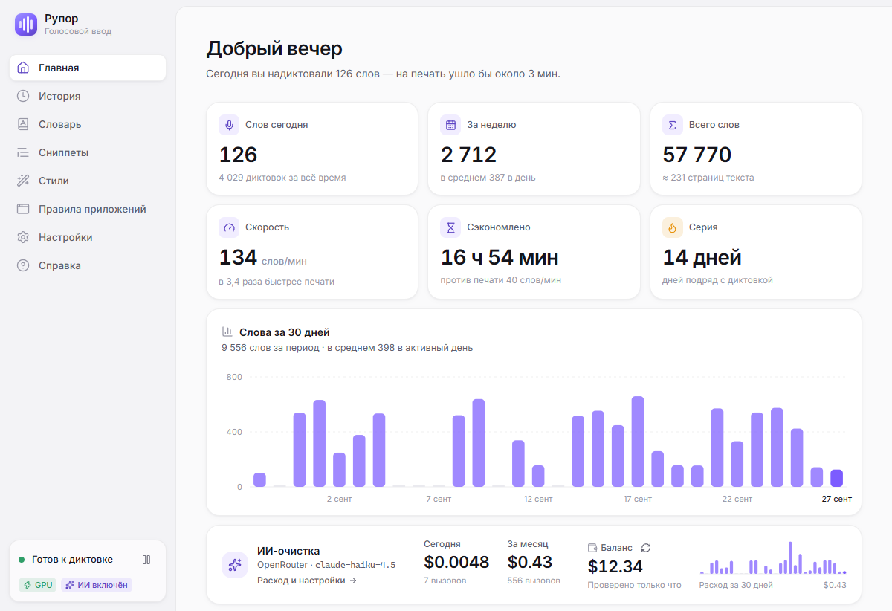
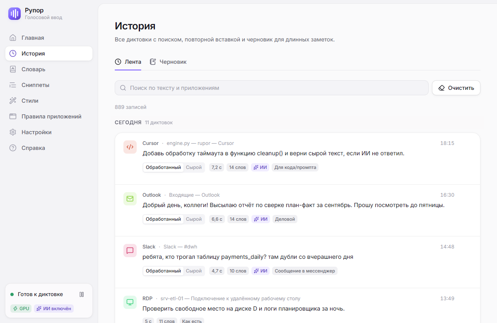
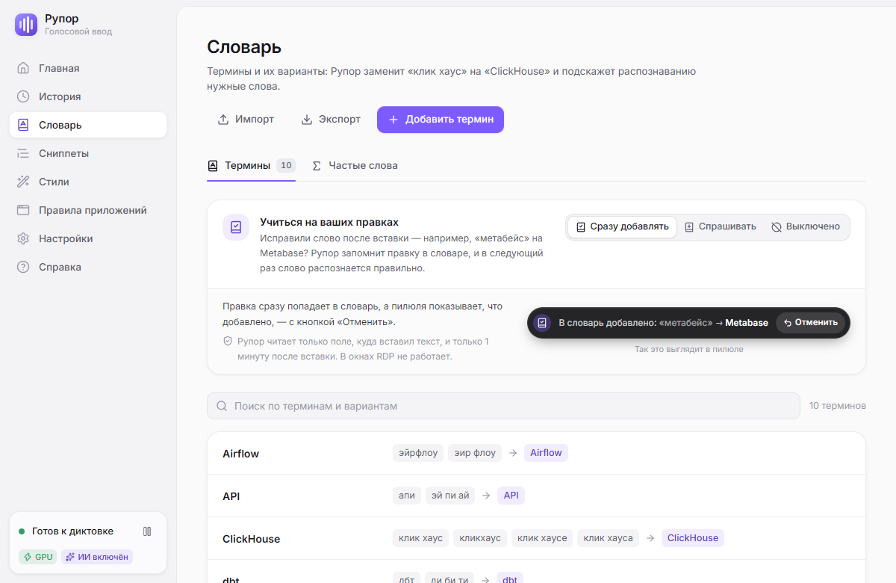
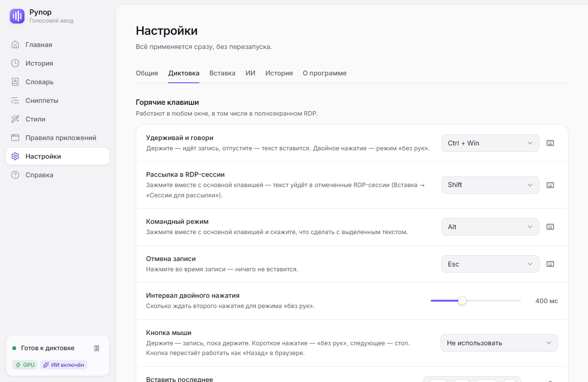
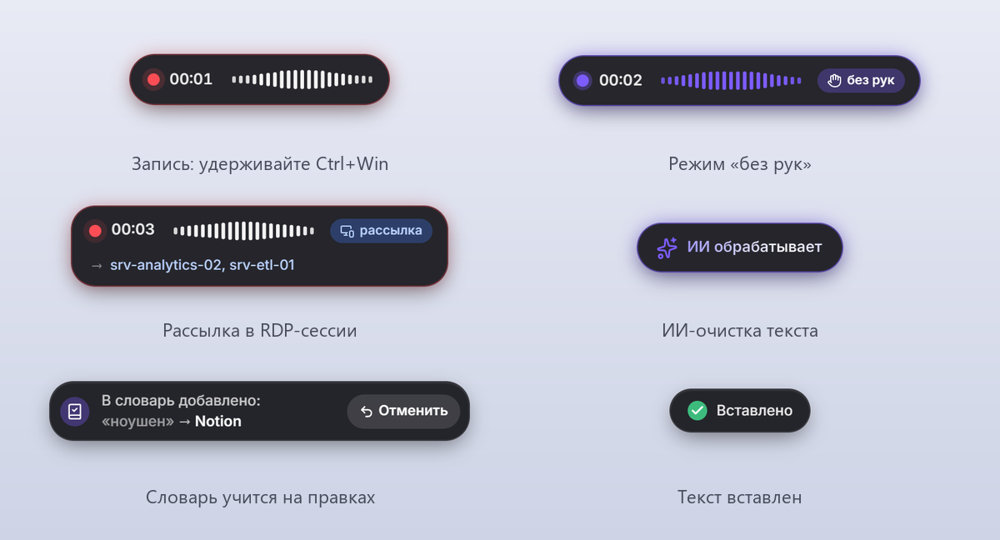
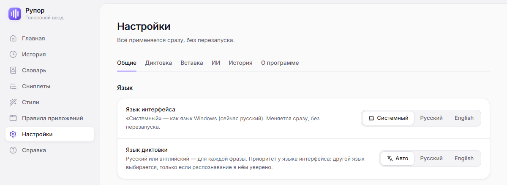

# Рупор — голосовая диктовка для Windows

[English](README.md) · **Русский**

**Рупор** — бесплатная программа с открытым кодом. Зажмите **Ctrl+Win**, скажите фразу,
отпустите — текст появится в окне, где стоит курсор. Рупор работает в любом приложении:
браузере, мессенджере, почте, IDE, Office — и в **RDP-сессиях**, в том числе с отключённым
буфером обмена (туда текст печатается клавишами). Одну фразу можно отправить сразу в несколько
удалённых сессий.

Распознавание идёт **локально на видеокарте** (faster-whisper `large-v3-turbo`, CUDA): голос
никуда не отправляется, после первой настройки интернет не нужен. Фраза длиной 13,5 секунды
вставляется примерно через 0,65 с после того, как вы отпустили клавиши (на RTX 3060 Ti).
По желанию можно включить **ИИ-очистку** через свою учётную запись OpenRouter. Она убирает
слова-паразиты, расставляет пунктуацию и оформляет текст под задачу: деловое письмо, сообщение
в мессенджер, промпт для кода. Идея та же, что у Wispr Flow, только распознавание локальное
и есть режимы для удалённых рабочих столов.

Интерфейс — **на русском и английском**, язык переключается в настройках на лету. Диктовать
можно по-русски (в том числе с английскими терминами) и по-английски. По-английски программа
называется **Rupor**.



## Содержание

- [Скриншоты](#скриншоты)
- [Возможности](#возможности)
- [Язык](#язык)
- [Системные требования](#системные-требования)
- [Установка](#установка)
- [Как пользоваться](#как-пользоваться)
- [Словарь, сниппеты, история](#словарь-сниппеты-история)
- [ИИ-очистка](#ии-очистка)
- [Приватность и данные](#приватность-и-данные)
- [Настройки](#настройки)
- [Замеры](#замеры)
- [Сборка из исходников](#сборка-из-исходников)
- [Структура проекта](#структура-проекта)
- [Лицензия](#лицензия)
- [Благодарности](#благодарности)

## Скриншоты

| | |
|---|---|
|  |  |
| **История**: поиск, сырой и обработанный текст, повторная вставка | **Словарь**: термины, варианты написания, обучение на правках |
|  |  |
| **Настройки**: клавиши, вставка, ИИ, история | **Пилюля** внизу экрана: запись, «без рук», рассылка, ИИ, словарь |

Скриншоты сняты в демо-режиме интерфейса, все данные на них вымышлены.

## Возможности

- **Диктовка в любое окно.** Удерживайте клавишу и говорите или включите режим «без рук»
  двойным нажатием. Запись можно запускать и мышью: щелчком по пилюле или кнопкой мыши.
- **RDP и виртуальные машины.** В `mstsc`, mRemoteNG, RDCMan, RemoteApp, Citrix, Hyper-V,
  VMware и VirtualBox текст печатается клавишами и доходит даже при отключённом буфере.
  Кириллица и эмодзи вводятся при любой раскладке.
- **Рассылка в RDP**: одна фраза по очереди уходит во все отмеченные удалённые сессии.
- **Локальное распознавание** на GPU (CUDA). Без видеокарты NVIDIA Рупор работает на процессоре.
- **ИИ-очистка** (по желанию): убирает паразиты и самопоправки, расставляет пунктуацию,
  оформляет текст по стилю. Если ИИ не ответил, вставляется исходный текст — **диктовка не теряется**.
- **Командный режим**: выделите текст, зажмите Ctrl+Win+Alt и скажите «сделай вежливее»,
  «переведи на английский» или «сократи» — выделенное заменится результатом.
- **Словарь** терминов и вариантов написания («клик хаус» → ClickHouse) с учётом падежей.
  **Обычно хватает одного термина**: похожие по звучанию написания Рупор узнаёт сам
  («Xena браузер», «Zenobowser» → ZennoBrowser). Термины из словаря подсказываются распознаванию.
- **Словарь учится на правках.** Исправили слово после вставки — Рупор предложит (или сразу
  добавит) замену, и в следующий раз слово распознается правильно.
- **Частые слова и контекст.** Имена и термины из ваших диктовок, а также текст перед курсором
  подсказываются распознаванию. Всё это считается и хранится на компьютере (термины уходят
  ИИ-очистке, только если она включена).
- **Сниппеты**: голосовой триггер → готовый текст («мой имейл» → адрес).
- **Правила приложений**: свой способ вставки и стиль ИИ для программы или для окна с
  определённым заголовком (Telegram — «Сообщение в мессенджер», VS Code — «Для кода»).
- **История и черновик**: поиск, повторная вставка, срок хранения. Историю можно не вести вовсе.
- **Статистика**: сколько слов надиктовано, скорость, сэкономленное время, серия дней.
- **Приглушение звука** других программ на время записи: музыки, созвона, звука из RDP.
- **Русский и английский**: язык интерфейса меняется на лету, язык диктовки определяется для
  каждой фразы или задаётся жёстко.
- Трей, автозапуск, светлая и тёмная темы, акцентный цвет, мастер первого запуска.

## Язык

Рупор работает на русском и английском — и интерфейс, и диктовка.

- **Язык интерфейса** — «Настройки → Общие → Язык»: «Системный» (по умолчанию), «Русский»,
  «English». «Системный» — как язык интерфейса Windows: русский для русской, белорусской,
  украинской и казахской Windows, для остальных — английский. Меняется сразу, без перезапуска:
  окна, меню трея, уведомления и ошибки ядра, названия стилей ИИ переключаются вместе. С выбора
  языка начинается и мастер первого запуска.
- **Язык диктовки** — там же: «Авто» (по умолчанию), «Русский», «English». В режиме «Авто»
  фраза распознаётся на языке интерфейса, а на другом языке — только если модель в нём уверена
  (настройка `en_threshold`, по умолчанию 0,8). «Русский» или «English» — всегда этот язык,
  без определения.
- **ИИ-очистка** берёт промпт на языке надиктованного текста: английскую диктовку чистит
  английский промпт (паразиты *um, uh, like, you know, basically*, самопоправки *no wait…*,
  *scratch that*), русскую — русский. Командный режим отвечает на языке интерфейса.
- **Установщик** спрашивает язык (English или Russian): на нём название в мастере установки,
  в деинсталляторе и в записи «Установленных приложений» (название и издатель). Там, где имя —
  часть самой установки, программа по-прежнему называется «Рупор», поэтому у тех, кто уже
  пользуется Рупором, путь установки и автозапуск не меняются: папка установки
  (`%LOCALAPPDATA%\Рупор`), ярлыки в меню «Пуск» и на рабочем столе, страница
  переустановки и обновления в установщике («Рупор <версия> is already installed…») и — имя
  записано в сам `rupor.exe` — диспетчер задач, «Автозагрузка» и настройки значков в области
  уведомлений.



## Системные требования

| | |
|---|---|
| Система | Windows 10 или 11, 64-разрядная |
| Видеокарта | рекомендуется NVIDIA GeForce RTX 20xx или новее, от 4 ГБ видеопамяти, драйвер с поддержкой CUDA 12 (528 или новее, лучше актуальный). Без NVIDIA распознавание идёт на процессоре — работает, но заметно медленнее |
| Диск | около 3 ГБ: программа ≈ 0,3 ГБ, модель распознавания ≈ 1,6 ГБ, библиотека CUDA cuBLAS ≈ 0,55 ГБ |
| Интернет | только при первом запуске (загрузка модели и cuBLAS) и для ИИ-очистки, если вы её включите |
| Прочее | микрофон; компонент WebView2 (в Windows 10/11 обычно уже есть, если нет — установщик скачает его сам) |

## Установка

1. Скачайте `Rupor_<версия>_x64-setup.exe` со страницы
   [Releases](https://github.com/listapad2024/rupor/releases/latest).
2. Запустите установщик и выберите язык. Установщик не подписан сертификатом издателя, поэтому
   Windows SmartScreen покажет окно «Система Windows защитила ваш компьютер» с пометкой
   «Неизвестный издатель». Нажмите **«Подробнее» → «Выполнить в любом случае»**. Браузер тоже
   может предупредить, что файл скачивают редко. Если не хотите запускать чужую сборку,
   соберите установщик сами — см. [Сборка из исходников](#сборка-из-исходников).
3. Рупор ставится для текущего пользователя в `%LOCALAPPDATA%\Рупор`, права администратора
   не нужны. Программа живёт в трее, окно открывается щелчком по значку.
4. При первом запуске откроется мастер:
   1. язык интерфейса;
   2. выбор микрофона и проверка уровня;
   3. проверка видеокарты и загрузка модели распознавания (≈ 1,6 ГБ, с HuggingFace) и
      библиотеки CUDA cuBLAS (≈ 0,55 ГБ, с PyPI) — один раз, дальше всё работает без сети;
   4. тестовая фраза — скажите что-нибудь и посмотрите на результат;
   5. горячие клавиши;
   6. ключ OpenRouter для ИИ-очистки (шаг можно пропустить);
   7. запуск вместе с Windows.

Автозапуск с Windows включён по умолчанию; выключается он в мастере или в «Настройки → Общие».
После настройки Рупор запускается сразу в трей. Если модель и библиотеки уже есть на компьютере
при первом запуске, мастер не открывается.

**Удаление**: «Параметры → Приложения → Установленные приложения» (в Windows 10 — «Приложения
и возможности») → Рупор (или Rupor, если установщик был на английском) → Удалить. Галочка
«Удалить данные приложения» стирает настройки, историю, журналы, библиотеки CUDA и ключи ИИ из
диспетчера учётных данных. Модель лежит в общем кэше HuggingFace
(`%USERPROFILE%\.cache\huggingface\hub\models--mobiuslabsgmbh--faster-whisper-large-v3-turbo`),
её при необходимости удалите вручную.

## Как пользоваться

| Действие | Как (по умолчанию) |
|---|---|
| Удерживай и говори | зажмите **Ctrl+Win**, говорите, отпустите — текст вставится |
| Без рук | **дважды** коротко нажмите Ctrl+Win, говорите, в конце нажмите Ctrl+Win ещё раз |
| Рассылка в RDP-сессии | во время записи зажмите ещё и **Shift** (Ctrl+Win+Shift) |
| Командный режим | выделите текст, зажмите **Ctrl+Win+Alt**, скажите, что с ним сделать, отпустите |
| Мышью: пилюля | **щелчок по пилюле** — запись «без рук», ещё щелчок — стоп и вставка; правый щелчок — окно Рупора |
| Мышью: кнопка | «Настройки → Диктовка → Кнопка мыши»: колёсико или боковая кнопка; держать — запись, короткое нажатие — «без рук» |
| Отменить запись | **Esc** во время записи |
| Вставить последнее | **Ctrl+Alt+Shift+V** (или пункт в трее) |
| Скопировать последнее | **Ctrl+Alt+Shift+C** |

Все клавиши меняются в «Настройки → Диктовка» и применяются сразу, без перезапуска. Клавишей
диктовки может быть сочетание модификаторов (Ctrl+Alt…) или одна клавиша (правый Ctrl, F13…).

**Пилюля** — маленький индикатор внизу экрана. Она показывает запись (волну голоса и таймер),
распознавание, работу ИИ и ошибки. Пилюля не забирает фокус, поэтому текст уходит в ваше окно.
Её можно перетащить или скрыть в настройках.

**Рассылка в RDP.** Отметьте нужные сессии галочками в «Настройки → Вставка → Сессии для
рассылки» или в меню трея. Сессия — это имя сервера из заголовка окна `mstsc` (для mRemoteNG и
RDCMan — окно менеджера целиком). Когда вы диктуете с Shift, Рупор по очереди активирует окна
отмеченных сессий, печатает текст и возвращает фокус; во время записи пилюля показывает, куда
уйдёт текст. Если не отмечена ни одна открытая сессия, текст никуда не рассылается, его можно
вставить через «Вставить последнее». Если во время рассылки фокус ушёл (щелчок, Alt+Tab, окно
разрыва связи), рассылка прерывается. У mRemoteNG и RDCMan все вкладки — одно окно, поэтому
текст получит только активная вкладка.

**Командный режим** работает через ИИ: OpenRouter или локальный Claude Code CLI (`claude -p`).
Рупор читает выделенный текст, отправляет его ИИ вместе с вашей командой и заменяет выделение
ответом. Если за это время вы переключили окно, нажимали клавиши или выделение изменилось,
ответ не вставляется, а сохраняется для «Вставить последнее». В терминалах и в RDP-сессиях без
общего буфера командный режим не работает.

<details>
<summary><b>Подробнее: клавиши, способы вставки, правила, звук</b></summary>

#### Клавиши

- Обычные сочетания с Ctrl+Win (Ctrl+Win+D, Ctrl+Win+стрелки) работают как прежде: если за
  время удержания нажата другая клавиша, запись тихо выбрасывается. Удержание короче 0,25 с
  тоже не считается диктовкой.
- Shift и Alt, нажатые во время записи, до приложений не доходят (Alt+Shift не переключит
  раскладку), а отпущенный после диктовки Win не открывает «Пуск». Esc, отменивший запись,
  тоже не доходит до окна. После Ctrl+Alt+Del, окна UAC или блокировки экрана зажатые клавиши
  сбрасываются.
- Следующую фразу можно начинать, пока предыдущая ещё печатается: печать подождёт, пока вы
  отпустите клавиши, и перевод строки не превратится в Ctrl+Enter.
- Запись длиннее 10 минут останавливается сама (например, если забыли выключить «без рук»).
  Если микрофон перестал давать звук (гарнитуру переподключили), Рупор сообщит об этом и
  переоткроет устройство.
- Если Ctrl+Alt «не работает», проверьте, не шлёт ли клавиша с надписью Alt на самом деле Win
  (так бывает у клавиатур в «маковском» режиме): Рупор слушает то, что видит Windows.

#### Способы вставки

- **Авто** (по умолчанию): в окна RDP-клиентов, RemoteApp, Citrix и консоли виртуальных машин
  текст **печатается клавишами**, в остальные — **вставляется через буфер** (прежнее содержимое
  буфера потом восстанавливается).
- **Печать клавишами**: `SendInput` с `KEYEVENTF_UNICODE`. Кириллица и эмодзи проходят при
  любой раскладке, в RDP работает и с выключенным буфером. Перевод строки и Tab отправляются
  скан-кодами, поэтому в RDP они не теряются.
- **Через буфер**: сохранить буфер → Ctrl+V → дождаться, пока окно заберёт текст → восстановить
  буфер. Временный текст помечен так, что не попадает в журнал буфера Windows (Win+V),
  облачную синхронизацию и менеджеры буфера.

Текст вставляется только в то окно, где вы диктовали. Если к моменту вставки активно другое окно
или фокус ушёл посреди печати, остаток не уйдёт в чужое окно: текст сохранится в «Вставить
последнее» и в истории.

**Окна, запущенные от администратора**, не принимают ввод от обычных программ (UIPI). Рупор
предупредит об этом и предложит перезапуститься с правами администратора.

**Ограничения вставки через буфер**: пока Рупор вставляет текст, приложение теряет владение
буфером — диапазон, вырезанный в Excel (Ctrl+X), после диктовки вставится копией, а фигуры
Office не восстанавливаются. Если это мешает, задайте для приложения правило «Печать клавишами».

#### Правила приложений и окон

**Правила приложений** задают для программы способ вставки и стиль ИИ. Из коробки: Telegram —
«Сообщение в мессенджер», Outlook — «Деловой», Cursor и VS Code — «Для кода». В разделе
«Правила приложений» есть список недавних программ: правило добавляется в один щелчок.

**Правила по названию окна** точнее правил приложений: «в Chrome, если в заголовке есть
YouTube Studio, — стиль „Деловой“», «в любом окне с `srv-analytics` — печать клавишами».
Процесс — имя exe или `*` (любое окно), название — часть заголовка без учёта регистра;
работает и для вкладок браузера. Приоритет: правило по названию (из нескольких подходящих —
с самым длинным названием) → правило приложения → общие настройки.

#### Звук компьютера во время записи

Пока идёт запись, Рупор может приглушать звук других программ — музыку, видео, созвон, звук
удалённого компьютера в RDP — до заданного уровня (по умолчанию 15 %) или выключать его, а после
записи возвращает всё как было. Настройка: «Настройки → Диктовка → Звук компьютера во время
записи» («Не трогать» / «Приглушать» / «Выключать»).

Меняется громкость программ в микшере Windows, а не общий уровень: звуки самого Рупора и
системные звуки не трогаются. Программа, которая заиграла во время записи, тоже приглушается.
Если вы сами поменяли громкость программы во время записи, Рупор её больше не трогает и после
записи не «возвращает». Если Рупор закрылся аварийно посреди записи, громкость восстановится
при следующем запуске (изменения заранее записываются в `%APPDATA%\Rupor\duck.json`).

</details>

## Словарь, сниппеты, история

- **Словарь**: термин и варианты написания («клик хаус», «кликхаус» → ClickHouse). Замена идёт
  по целым словам без учёта регистра и «ё», с падежами («в клик хаусе» → «в ClickHouse»).
  Термины словаря подсказываются распознаванию. Словарь импортируется и экспортируется в JSON.
- **Похожие написания** (включено по умолчанию, Словарь → «Узнавать похожие написания»): термин
  вносится один раз, а написания, которые *звучат* как он, исправляются без списка вариантов —
  латиницей и кириллицей, слитно и раздельно, с падежами: «Zenobowser», «Xena браузер»,
  «в зенно браузере» → ZennoBrowser. Настоящие слова не заменяются: проверка орфографии Windows
  (русская и английская) отличает ошибку распознавания («кубернетис», «Xenoposter») от слова,
  которое лишь созвучно термину («курсор», «редис», cloud). Варианты нужны для совсем непохожих
  ошибок, для терминов из двух обычных слов («клик хаус») и очень коротких (до 3 звуков). Слова,
  которые вы сами часто диктуете, тоже считаются настоящими. Без словарей проверки орфографии
  Windows работают только точные варианты. Пути, адреса и имена файлов не трогаются;
  инструкция командного режима — только по точным вариантам. Словарь — последнее слово: он
  применяется и после ИИ-очистки, а
  ошибки распознавания не попадают ни в подсказку распознаванию, ни в термины для ИИ.
- **Обучение на правках.** После вставки Рупор до минуты следит за полем ввода (через Windows
  UI Automation: Блокнот, Telegram Desktop, поля браузеров на Chromium, Word). Если вы исправили
  слово, которое было распознано неверно («метабейс» → Metabase), пилюля покажет уведомление.
  Режимы (`learn_mode`): **сразу добавлять** — с кнопкой «Отменить» (по умолчанию),
  **спрашивать** — с кнопкой «Добавить», **выключено**.
- **Частые слова**: из истории Рупор сам собирает характерные для вас слова — термины латиницей,
  аббревиатуры, имена, редкие слова — и подсказывает их распознаванию. Любое слово можно
  исключить. При выключенной истории частоты не собираются.
- **Текст в окне**: в момент нажатия клавиши Рупор читает 1–2 предложения перед курсором и
  подсказывает их распознаванию — продолжение фразы распознаётся точнее. Текст нигде не
  сохраняется.
- **Сниппеты**: голосовой триггер → текст («мой имейл» → адрес). Если сработал сниппет, ИИ не
  вызывается. Сниппеты тоже импортируются и экспортируются в JSON.
- **История**: время, приложение, сырой и обработанный текст, длительность; поиск, копирование,
  повторная вставка, удаление, очистка за день/неделю/месяц, срок хранения. Историю можно
  выключить совсем.
- **Черновик** (вкладка в «Истории»): длинная заметка диктуется прямо в окно Рупора, без вставки
  в другие программы.
- **Статистика** на главной: слова за день/неделю/всё время, скорость (слов в минуту),
  сэкономленное время против печати (40 слов в минуту), серия дней подряд, график за 30 дней.
  Считается всегда, даже если история выключена.

<details>
<summary><b>Подробнее: что выучивается, а что нет</b></summary>

Выучиваются только правки, похожие на ошибку распознавания: новое слово похоже на термин
(латиница, цифры, смешанный регистр вроде ClickHouse, аббревиатура, имя с заглавной не в начале
предложения) и звучит похоже на старое.

Не выучиваются: замена слова по смыслу («завтра» → «послезавтра»), грамматика («Наташа» →
«Наташе»), замена похожего продукта или номера (React → Preact, TASK-12 → TASK-13), перевод
обычного слова («проект» → project), оформление и заглавные у обычных слов, пунктуация,
удаление и добавление слов, числа, слова короче 3 букв и частые слова.

В сомнительных случаях Рупор даже в режиме «сразу добавлять» спрашивает, а на второй такой же
правке добавляет сам: короткое слово (до 4 букв), одно имя заменено похожим, только заглавная
у русского слова, перевод в строчную латиницу («вебхук» → webhook), правка в английском тексте,
слово простояло в поле меньше секунды. Недопечатанное слово (Enter сразу после последней буквы)
не выучивается совсем.

Наблюдение за полем заканчивается, когда фокус ушёл, поле очистилось (сообщение отправлено),
через минуту или с началом новой диктовки. Окна RDP, рассылка и командный режим не
отслеживаются, поля паролей не читаются никогда. Текст поля никуда не отправляется и не пишется
в журнал.

</details>

## ИИ-очистка

ИИ-очистка по умолчанию **выключена**: без неё Рупор работает полностью офлайн. Включается она
в «Настройки → ИИ».

- **Провайдер.** По умолчанию — [OpenRouter](https://openrouter.ai) с моделью
  `anthropic/claude-haiku-4.5` (модель можно сменить). Также поддерживаются Anthropic API
  напрямую (свой ключ) и [Ollama](https://ollama.com) — локальная модель, полностью офлайн.
  Нужна **своя учётная запись** у провайдера: запросы оплачиваются с вашего баланса. Одна
  очистка стоит порядка $0,001 (замеры — в [docs/BENCH.md](docs/BENCH.md)).
- **Ключ** хранится только в диспетчере учётных данных Windows (Credential Manager, записи
  `Rupor/openrouter`, `Rupor/anthropic`). Его можно вставить в настройках или импортировать из
  файла `.env` с переменной `openrouter_api_key`. В интерфейсе видна только маска вида
  `sk-or-v1-…XYZ`; в журналы и историю ключ не попадает.
- **Стили**: «Как есть» (без ИИ), «Обычный», «Деловой», «Сообщение в мессенджер», «Для
  кода/промпта». Стиль берётся из правила приложения, иначе — стиль по умолчанию.
- **Язык**: промпт — на языке текста. Английскую диктовку чистит английский промпт (убирает
  *um, uh, like, you know, basically* и самопоправки, оформляет числа, термины и списки, на
  вопросы из текста не отвечает), русскую — русский. Если язык текста неочевиден (одно-два
  слова, смесь письменностей), решает язык распознавания.
- **Режимы**: «Ждать очистку» — вставляется только очищенный текст; «Сначала сырой» — текст
  вставляется сразу, а очищенный заменяет его, когда придёт (только если вы ничего не нажимали,
  окно и поле те же, и слева от курсора стоит ровно вставленный текст).
- Фразы короче порога (по умолчанию 6 слов) в ИИ не отправляются. При ошибке или таймауте
  (5 с) вставляется текст без обработки и появляется уведомление.
- **Расход**: каждый вызов записывается локально (модель, токены, стоимость). В «Настройки → ИИ →
  Расход» — итоги за день, неделю, месяц и всё время, график по дням и баланс OpenRouter. Если
  на балансе меньше $1, Рупор предупредит (не чаще раза в сутки).

**Что уходит в сеть при включённом ИИ.** Провайдеру отправляются: распознанный текст фразы,
инструкция по выбранному стилю и список терминов (из вашего словаря и частых слов), чтобы ИИ
писал их правильно. В командном режиме — ваша голосовая команда и выделенный текст. Аудио,
история, названия окон и текст из полей ввода не отправляются. Для проверки ключа и баланса
Рупор обращается к OpenRouter (`/api/v1/key`, `/api/v1/credits`) по кнопке «Проверить» и
автоматически не чаще раза в 5 минут — только если очистка или команды идут через OpenRouter.
С Ollama всё остаётся на компьютере.

## Приватность и данные

- **Распознавание — локально.** Звук с микрофона обрабатывается на вашем компьютере и нигде не
  сохраняется.
- **Телеметрии и аналитики нет.** В сеть Рупор ходит только за моделью (HuggingFace) и
  библиотекой cuBLAS (PyPI) при первом запуске и к выбранному ИИ-провайдеру, если ИИ включён.
- **Текст диктовок в журналы не пишется**: там только длины текста, время и имена программ.
- Ядро и окна общаются через WebSocket на `127.0.0.1` со случайным портом и токеном; страницы
  в браузере к ядру не подключатся.
- Удалённая запись истории затирается и в базе, и в её журнале (`rupor.db-wal`).

| Что | Где |
|---|---|
| Настройки | `%APPDATA%\Rupor\settings.json` |
| История, словарь, сниппеты, статистика, черновик, расход ИИ, частые слова | `%APPDATA%\Rupor\rupor.db` (SQLite) |
| Журналы (с ротацией, всегда на русском) | `%APPDATA%\Rupor\logs\` (`rupor.log`, `ui.log`, `crash.log`) |
| Громкость приглушённых программ (только во время записи) | `%APPDATA%\Rupor\duck.json` |
| Модель распознавания | `%USERPROFILE%\.cache\huggingface\hub` |
| Библиотеки CUDA | `%LOCALAPPDATA%\Rupor\cuda` |
| Ключи ИИ | диспетчер учётных данных Windows: `Rupor/openrouter`, `Rupor/anthropic` |

## Настройки

Всё настраивается в окне Рупора. Файл `%APPDATA%\Rupor\settings.json` можно править и вручную
(после правки перезапустите Рупор).

<details>
<summary><b>Основные ключи <code>settings.json</code></b></summary>

| Ключ | Что это |
|---|---|
| `language` | язык интерфейса и сообщений: `system` (по умолчанию — как язык Windows: русский для русской, белорусской, украинской и казахской, иначе английский) / `ru` / `en` |
| `dictation_language` | язык распознавания: `auto` (по умолчанию — язык интерфейса, другой только при уверенности модели не ниже `en_threshold`) / `ru` / `en` |
| `en_threshold` | уверенность модели, при которой в режиме `auto` выбирается второй язык (0–1, по умолчанию 0,8) |
| `ptt_key` | клавиша диктовки: сочетание `ctrl+win` (по умолчанию), `ctrl+alt`… или одна клавиша `rctrl`, `f13`, `vk:0x..` |
| `broadcast_modifier`, `command_modifier`, `cancel_key` | одна клавиша: `shift`, `alt`, `esc` (по умолчанию), `rshift`, `ralt`, `capslock`, `f13`…`f24` |
| `insert_last_hotkey`, `copy_last_hotkey` | сочетания вида `ctrl+alt+shift+v`; пустая строка — выключено |
| `tap_max_ms`, `double_tap_ms` | пороги короткого и двойного нажатия |
| `input_device` | микрофон: часть имени или индекс; `null` — системный |
| `model`, `device`, `compute_type`, `beam_size` | модель распознавания; смена — перезагрузка модели в фоне |
| `terms` | термины-подсказки для распознавания (к ним добавляются термины словаря) |
| `insert_mode` | `auto` / `type` / `clipboard` |
| `learn_mode` | обучение словаря на правках: `auto` (по умолчанию) / `suggest` / `off` |
| `dict_fuzzy` | узнавать написания, похожие на термин словаря по звучанию: `true` (по умолчанию) / `false` |
| `app_rules` | `{"telegram.exe": {"insert_mode": null, "style": "messenger"}}` |
| `title_rules` | `[{"process": "chrome.exe", "title": "YouTube Studio", "insert_mode": null, "style": "business"}]` |
| `type_delay_ms`, `rdp_type_delay_ms` | задержка между символами при печати (0–30 мс) |
| `rdp_classes`, `rdp_processes` | как узнавать RDP-окна |
| `broadcast_targets` | RDP-сессии для рассылки (имена серверов или заголовки окон) |
| `vocab_enabled`, `context_enabled` | подсказки распознаванию: частые слова; текст перед курсором |
| `duck_mode`, `duck_level` | звук других программ во время записи: `duck` (приглушить до `duck_level` %, по умолчанию 15) / `mute` / `off` |
| `unload_after_min` | выгружать модель из видеопамяти после N минут простоя (0 — никогда) |
| `history_enabled`, `history_retention_days` | история и срок её хранения (0 — всегда) |
| `default_style`, `ai_enabled`, `ai_provider`, `ai_model`, `ai_mode`, `ai_min_words`, `ai_timeout_s` | ИИ-очистка |
| `ai_provider_order` | предпочтительные провайдеры внутри OpenRouter, например `["google-vertex", "amazon-bedrock"]` |
| `command_provider` | командный режим: `openrouter` или `claude_cli` |
| `env_path` | путь к файлу `.env` с `openrouter_api_key` для импорта ключа; необязательно, по умолчанию пусто |
| `theme`, `accent`, `pill_enabled`, `pill_position`, `sounds` | внешний вид, пилюля, звуки |

</details>

## Замеры

Тестовая машина: Ryzen 9 7950X, RTX 3060 Ti 8 ГБ, Windows 11. Методика и подробные результаты —
в [docs/BENCH.md](docs/BENCH.md).

| Что | Результат |
|---|---|
| Загрузка модели из кэша | 2–3 с |
| Фраза 13,5 с: от отпускания клавиши до начала вставки | ≈ 650 мс |
| Раннее определение языка (по первым 2,5 с речи) | экономит ≈ 220 мс |
| ИИ-очистка через OpenRouter, медиана, русский текст | ≈ 1,2 с, ≈ $0,00125 за фразу |
| ИИ-очистка через OpenRouter, медиана, английский текст | ≈ 1,3 с, ≈ $0,0009 за фразу |

Точность распознавания (WER) пока измерена только на русской речи.

## Сборка из исходников

Рупор состоит из двух процессов:

- **`rupor.exe`** (Tauri 2 + React; в диспетчере задач — «Рупор») — главное окно, пилюля, значок
  в трее; он же запускает ядро и перезапускает его, если оно упало;
- **ядро** (Python) — хоткеи, микрофон, распознавание, вставка текста, история, ИИ. Окна
  общаются с ним по WebSocket на `127.0.0.1`. Протокол и все контракты — в
  [docs/ARCHITECTURE.md](docs/ARCHITECTURE.md).

**Что нужно**:

- Windows 10/11 x64;
- Python 3.13 (`py -3.13`);
- Node.js 20.19+ или 22.12+ с npm;
- Rust stable с целевой платформой MSVC (`rustup default stable-x86_64-pc-windows-msvc`);
- Visual Studio Build Tools с компонентом «Разработка классических приложений на C++»
  (MSVC и Windows SDK).

**Окружение и проверки**:

```bat
git clone https://github.com/listapad2024/rupor.git
cd rupor
py -3.13 -m venv .venv
.venv\Scripts\pip install -e ".[dev]"
cd ui && npm install && cd ..

.venv\Scripts\python -m pytest -q
.venv\Scripts\python -m mypy core/rupor
cd ui && npm run typecheck && npm run build && npm run check:i18n && cd ..
cd ui\src-tauri && cargo clippy --all-targets -- -D warnings && cargo test && cd ..\..
```

Тесты не нажимают клавиш за вас, не трогают ваш буфер обмена и звук: вставка и активные окна
подменены, настоящий буфер проверяется в отдельном процессе со своей window station, а
приглушение — на собственной аудиосессии теста. Если нужного устройства нет (например, вывода
звука), такой тест пропускается.

Переводы тоже проверяются: `npm run check:i18n` сверяет ключи, формы множественного числа и
подстановки в `ui/src/i18n/ru.json` и `en.json` и следит, чтобы в `en.json` и в коде интерфейса
не было кириллицы; `tests/test_i18n.py` делает то же для каталогов ядра `core/rupor/locales/*.json`.
Новые строки добавляются сразу в оба языка.

**Запуск из исходников** (debug-сборка оболочки берёт ядро из `.venv`):

```bat
run-dev.cmd                  :: собрать debug-версию (если её нет или она устарела) и запустить
run-dev.cmd build            :: только пересобрать — после правок в ui\src или ui\src-tauri
cd ui && npm run tauri dev   :: правка интерфейса на лету: Vite + окна Рупора, горячая перезагрузка
```

Интерфейс можно открыть и в обычном браузере без ядра: `cd ui && npm run dev`, затем
`http://localhost:1420/?mock=1&lang=ru` (или `lang=en`) — демо-режим с фейковым ядром и
вымышленными данными (остальные параметры демо — в [ui/README.md](ui/README.md)).

**Установщик**:

```bat
build.cmd          :: ядро (PyInstaller) → ui\src-tauri\resources\core → проверка → npm run tauri build
build.cmd core     :: только ядро, его копия в ресурсы Tauri и проверка
```

Готовый установщик — `ui\src-tauri\target\release\bundle\nsis\Рупор_<версия>_x64-setup.exe`
(≈ 55 МБ). На странице Releases тот же файл выкладывается как `Rupor_<версия>_x64-setup.exe`:
GitHub заменяет не-ASCII символы в именах файлов релиза. Ядро собирается без DLL CUDA и без
модели (их скачивает мастер первого запуска), а также без PyAV/FFmpeg: чтение аудиофайлов ему
не нужно.
Перед упаковкой `build.cmd` проверяет собранное ядро (`packaging\verify_core.py`) и
останавливается, если оно не той версии, что интерфейс. Поэтому собирайте установщик через
`build.cmd`, а не через `npm run tauri build`. `install-rupor.cmd` ставит свежую сборку на этот
компьютер молча (cuBLAS берётся из `.venv`, чтобы не качать заново) и запускает Рупор; журнал
установки — `%TEMP%\rupor_install.log`. Запускайте его из Проводника или обычной командной
строки, а не из терминала внутри приложения из Microsoft Store (MSIX): Windows перенаправит
запись установки в `AppData` в личное хранилище этого приложения.

<details>
<summary><b>Для разработчиков: флаги ядра, переменные окружения, утилиты</b></summary>

Флаги ядра (`python -m rupor` в папке `core`):

- `--sidecar --ws-port <порт> --token <токен> [--ui-pid <pid>]` — режим для интерфейса (ядро
  завершается вместе с процессом `--ui-pid`);
- `--no-hook`, `--no-mutex` — без хука клавиатуры и без проверки второго экземпляра (для тестов);
- `--cpu`, `-v`; `--file фраза.wav [--type]` — распознать файл (только `python -m rupor`: в
  собранное ядро PyAV для чтения аудиофайлов не входит);
- `--uia-selftest` — самопроверка сборки (UI Automation, частотные списки, Core Audio,
  каталоги сообщений), код выхода 0 — всё работает.

Переменные окружения:

- `RUPOR_CORE` — своя командная строка ядра для оболочки; `RUPOR_CORE_ARGS` — дополнительные
  аргументы, например `--no-hook --no-mutex -v`, чтобы тестовое ядро не перехватывало хоткеи;
- `RUPOR_CUDA_DIRS` — свои папки с DLL CUDA;
- `RUPOR_WS_ORIGINS` — дополнительные разрешённые Origin для WebSocket (через запятую, для отладки);
- `RUPOR_CONSOLE=1` — собрать ядро PyInstaller с консолью;
- `RUPOR_ENV_PATH` — путь к `.env` с ключом OpenRouter для `tools/ai_bench.py` (или `--env`).

Проверка протокола ядро ↔ интерфейс без Tauri: запустите ядро
`cd core && ..\.venv\Scripts\python -m rupor --sidecar --ws-port 8765 --token <токен> --no-hook --no-mutex`
и выполните `cd ui && npm run check:contract -- --port 8765 --token <токен> --quit`. Скрипт
проходит сценарии окон и сверяет каждый ответ и событие с типами `ui/src/lib/types.ts`.
С тем же ядром интерфейс открывается в браузере: `http://localhost:1420/?port=8765&token=<токен>`.

Утилиты в `tools/`:

- `ws_smoke.py` — дымовой тест настоящего ядра по WebSocket (временная папка настроек, без хука);
- `e2e.py`, `try_inject.py` — полный конвейер и вставка в собственное тестовое окно;
- `ai_bench.py`, `wer_bench.py` — качество ИИ-очистки и распознавания (`ai_bench.py --cases en` —
  английский набор; см. [docs/BENCH.md](docs/BENCH.md));
- `make_sample.py`, `bench_asr.py`, `prof_asr.py` — синтез фраз и замеры распознавания;
- `install_local.py`, `update_core.py` — установить свежую сборку или только ядро в установленный Рупор.

Чек-лист ручной проверки перед выпуском — в [docs/TESTING.md](docs/TESTING.md).

</details>

## Структура проекта

```
core/rupor/        ядро на Python: хоткеи, микрофон, распознавание, вставка, ИИ, SQLite
  data/            частотные списки русских и английских слов для словаря частот
  locales/         сообщения ядра на русском и английском (ru.json, en.json)
ui/src/            интерфейс на React: главное окно, мастер первого запуска, пилюля
  i18n/            строки интерфейса на русском и английском (ru.json, en.json)
ui/src-tauri/      оболочка на Rust (Tauri 2): окна, трей, запуск ядра, установщик NSIS
packaging/         сборка ядра PyInstaller и его самопроверка
tests/             тесты ядра (pytest)
tools/             бенчмарки, дымовые тесты, установка свежей сборки
docs/              архитектура и протокол, замеры, требования, план, скриншоты
build.cmd          сборка установщика
run-dev.cmd        запуск из исходников
install-rupor.cmd  установка своей сборки на этот компьютер
```

<details>
<summary><b>Модули ядра</b></summary>

| Модуль | Назначение |
|---|---|
| `engine.py` | поток диктовки, ИИ, командный режим, история, шина событий |
| `server.py`, `api.py` | WebSocket-сервер и команды протокола |
| `hotkeys.py` | хук `WH_KEYBOARD_LL` и автомат жестов |
| `audio.py` | микрофон, 16 кГц, пре-буфер 250 мс (первое слово не обрезается) |
| `asr.py` | faster-whisper, прогрев, откат на CPU, раннее определение языка, язык диктовки |
| `inject.py` | печать через `SendInput`, вставка через буфер, чтение выделения |
| `winutil.py` | активное окно, распознавание RDP-окон, слежение за фокусом, права администратора |
| `broadcast.py` | рассылка в RDP-сессии |
| `storage.py`, `textproc.py` | SQLite (история, словарь, расход ИИ, частоты слов); словарь, сниппеты, подсчёт слов |
| `fuzzy.py` | похожие написания терминов словаря: звучание, поиск фрагментов из 1–3 слов |
| `vocab.py`, `data/` | словарь частот: отбор характерных слов, контекст окна, подсказка распознаванию |
| `learn.py`, `uia.py` | обучение словаря на правках: сравнение текста поля и чтение поля через UI Automation |
| `duck.py` | приглушение других программ во время записи (Core Audio) |
| `ai.py`, `credman.py` | ИИ-провайдеры, стили, русский и английский промпты; Credential Manager |
| `i18n.py`, `locales/` | язык интерфейса: `tr(key)`, каталоги сообщений, язык Windows |
| `fetch.py` | загрузка модели и библиотек CUDA |
| `tray.py` | меню в трее для запуска ядра без интерфейса (`run-rupor.cmd`, пока нет debug-сборки) |

Устройство интерфейса — в [ui/README.md](ui/README.md), оболочки — в
[ui/src-tauri/README.md](ui/src-tauri/README.md), протокол — в
[docs/ARCHITECTURE.md](docs/ARCHITECTURE.md), исходные требования — в [docs/TZ.md](docs/TZ.md).

</details>

## Лицензия

Код Рупора распространяется по лицензии [MIT](LICENSE).

Сторонние компоненты — faster-whisper, CTranslate2, модель Whisper, Tauri, React и другие —
распространяются по своим лицензиям; список — в [THIRD_PARTY_NOTICES.ru.md](THIRD_PARTY_NOTICES.ru.md).
Библиотека NVIDIA cuBLAS и модель распознавания в установщик не входят: при первом запуске они
скачиваются с PyPI и HuggingFace на условиях их правообладателей.

## Благодарности

- [faster-whisper](https://github.com/SYSTRAN/faster-whisper) (SYSTRAN) — распознавание речи;
- [CTranslate2](https://github.com/OpenNMT/CTranslate2) (OpenNMT) — быстрый инференс на GPU и CPU;
- [OpenAI Whisper](https://github.com/openai/whisper) — модель распознавания; конвертация
  `large-v3-turbo` для faster-whisper — [mobiuslabsgmbh](https://huggingface.co/mobiuslabsgmbh/faster-whisper-large-v3-turbo);
- [Tauri](https://tauri.app) — оболочка приложения;
- а также React, Vite, Tailwind CSS, Framer Motion, Lucide, шрифт Inter, sounddevice,
  comtypes, websockets и другие проекты с открытым кодом.
